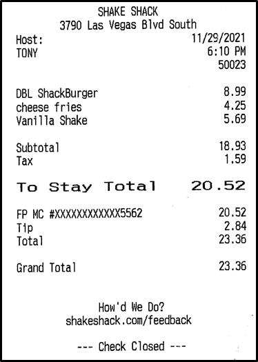
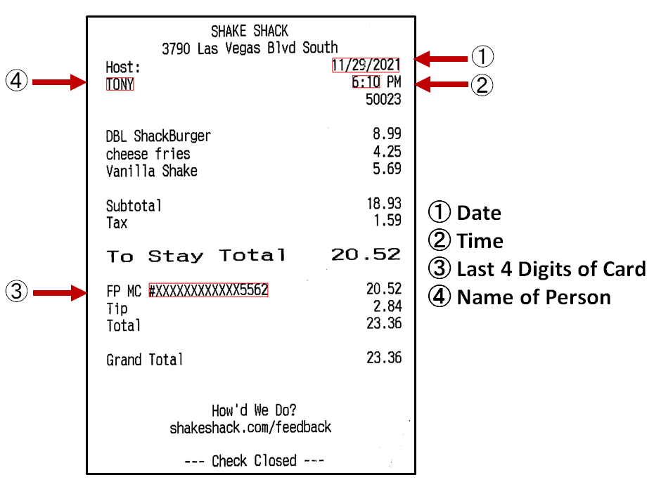

# SPII-Guard
Securing Personal Identifiable Information in Receipts Using Regular Expressions and Named Entity Recognition

SPII Guard is a novel algorithm that can detect sensitive information like the last 4 digits of credit cards, names, dates, and times within images. It was specifically created to address the risk of personal identifiable information in images of receipts falling into the hands of potentially ill-intentioned workers on Crowdsourcing platforms. However, this algorithm has potential for further applications. Future work can include expanding its censuring capabilities to automatically detecting sensitive information in passports, images of credit cards, drivers licenses, tax returns, medical records, and more.

## Try it

### In your browser (no install)

[](https://colab.research.google.com/github/Lightningstudy/SPII-Guard/blob/main/SPII_Guard_Demo.ipynb)

Click the badge, then **Runtime > Run all**. The notebook installs Tesseract, runs the detector on the sample receipt below, shows the original, the OCR word boxes, and the detected sensitive words side by side, and lets you upload your own receipt image to test. Setup takes about a minute.

### On your machine

You need Python 3.9+ and [Tesseract OCR](https://tesseract-ocr.github.io/tessdoc/Installation.html):

- Ubuntu/Debian: `sudo apt install tesseract-ocr`
- macOS: `brew install tesseract`
- Windows: [UB Mannheim installer](https://github.com/UB-Mannheim/tesseract/wiki), then pass `--tesseract-cmd "C:\Program Files\Tesseract-OCR\tesseract.exe"` if it is not on your PATH

Then:

```bash
git clone https://github.com/Lightningstudy/SPII-Guard.git
cd SPII-Guard
pip install -r requirements.txt        # installs OpenCV, pytesseract, spaCy and the en_core_web_sm model
python spii_guard_demo.py              # runs on images/originalReceipt.png
```

Output goes to `output/originalReceipt_detect.jpg` (red boxes around sensitive words). Expected console output:

```
Sensitive items detected: 4
  [date         ] '11/28/2021'             box=(279,47)-(354,63)
  [person       ] 'TONY'                   box=(17,66)-(54,92)
  [time         ] '6:10'                   box=(301,67)-(332,81)
  [last 4 digits] '#XXXXXXXXXXXXS562'      box=(72,302)-(206,317)
```

To scan your own image, or also save a picture of every word the OCR found:

```bash
python spii_guard_demo.py --image path/to/receipt.jpg --save-ocr --out-dir results
```

`spii_guard_demo.py` is a headless, cross-platform port of the original research script `src/SPII_Guard.py`: same OCR settings, same regular expressions, same NER filter, but with command line arguments and image files written to disk instead of pop-up windows and hardcoded Windows paths.

## How it works

1. **OCR.** Tesseract (`--oem 3 --psm 6`) reads every word on the receipt and returns its bounding box.
2. **Regular expressions** flag masked card numbers (`XXXX...5562`, `xx 1234`, `KK1234`), dates containing `/`, and times containing `:`.
3. **Named entity recognition.** spaCy's `en_core_web_sm` tags `PERSON` entities. A list of store names and job titles (Walmart, Cashier, ...) removes common false positives.
4. Boxes for every flagged word are drawn on a copy of the original image.

### Original Receipt
<br>
Original Receipt Credit: Walter, J. (2023)

### Algorithm Output
<br>
Original Receipt Credit: Walter, J. (2023)

## Repository layout

```
spii_guard_demo.py            Headless command line demo (start here)
SPII_Guard_Demo.ipynb         Google Colab notebook version of the demo
requirements.txt              Python dependencies
images/originalReceipt.png    Sample receipt used by the demo
images/finalReceiptWithInfo.png   Annotated result shown above
src/SPII_Guard.py             Original research script (Windows paths, GUI windows)
src/1. OCR_FINAL.ipynb        Original notebook the script came from
src/3. convert_pdf_to_png.ipynb   Helper for turning scanned PDF receipts into images
src/26. shakeshack-*.jpg      Second sample: receipt with OCR word boxes, and its detection result
```
